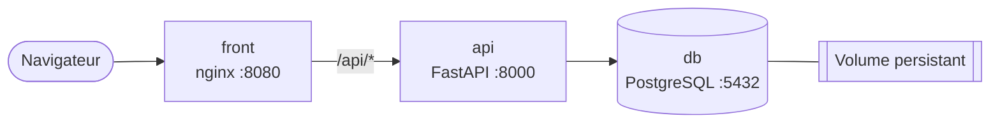

# AntiGaspi


Application anti-gaspillage alimentaire : les commerçants publient leurs paniers d'invendus à prix réduit, et les utilisateurs les consultent et les réservent.

Projet du cours Conteneurisation et orchestration (ESILV). L'application est découpée en microservices, conteneurisée avec Docker, lancée en local avec Docker Compose, déployée sur Kubernetes et livrée par un pipeline GitHub Actions.

## Sommaire

1. [Architecture](#architecture)
2. [Structure du dépôt](#structure-du-dépôt)
3. [Prérequis](#prérequis)
4. [Lancer en local avec Docker Compose](#lancer-en-local-avec-docker-compose)
5. [Déploiement sur Kubernetes](#déploiement-sur-kubernetes)
6. [CI/CD](#cicd)
7. [Tests](#tests)
8. [Organisation Git](#organisation-git)
9. [Choix techniques](#choix-techniques)
10. [Défis rencontrés](#défis-rencontrés)
11. [Utilisation de l'IA](#utilisation-de-lia)
12. [Pistes d'amélioration](#pistes-damélioration)

## Architecture

Trois services, chacun dans son conteneur :

| Service | Rôle | Technologie |
| --- | --- | --- |
| front | Page web (liste, publication, réservation, suppression de paniers). Il relaie aussi les appels `/api` vers l'API | HTML / CSS / JavaScript, servi par nginx (sans root) |
| api | API REST : gestion des paniers | Python, FastAPI, SQLAlchemy |
| db | Stockage des paniers | PostgreSQL 17 |



Le navigateur ne parle qu'au front. C'est nginx qui renvoie les requêtes `/api/...` vers l'API, en retirant le préfixe `/api`. Le nom de l'API dans la configuration nginx est `api`, ce qui fonctionne aussi bien avec Docker Compose qu'avec Kubernetes (le Service s'appelle aussi `api`).

Routes de l'API :

| Méthode | Route | Description |
| --- | --- | --- |
| GET | `/health` | Vérification de santé |
| GET | `/paniers` | Liste des paniers |
| POST | `/paniers` | Création d'un panier |
| POST | `/paniers/{id}/reserver` | Réserve un panier (quantité moins un) |
| DELETE | `/paniers/{id}` | Supprime un panier |

## Structure du dépôt

```text
.
├── api/                  service API (Dockerfile multi-stage, tests)
├── front/                service front (Dockerfile multi-stage, nginx.conf)
├── deploy/               manifestes Kubernetes
├── .github/workflows/    pipelines CI et release
├── docker-compose.yml    environnement de développement
└── .env.example          modèle du fichier de configuration
```

## Prérequis

- Docker Desktop (avec Kubernetes activé pour la partie Kubernetes)
- Git
- Python 3.12 ou plus, seulement pour lancer les tests en dehors de Docker

## Lancer en local avec Docker Compose

1. Créer le fichier `.env` à partir du modèle, puis y mettre son propre mot de passe :

   ```bash
   cp .env.example .env
   ```

   Sous PowerShell : `Copy-Item .env.example .env`

2. Lancer toute l'application :

   ```bash
   docker compose up --build
   ```

3. Ouvrir :
   - l'application : http://localhost:8080
   - la documentation de l'API : http://localhost:8000/docs

Les données sont conservées dans le volume `pgdata`. `docker compose down` arrête l'application en gardant les données, `docker compose down -v` supprime aussi le volume.

## Déploiement sur Kubernetes

Tous les manifestes sont dans `deploy/` et utilisent le namespace `antigaspi`.

| Fichier | Contenu |
| --- | --- |
| `00-namespace.yaml` | Namespace |
| `10-configmap.yaml` | Configuration non sensible (hôte, port, nom et utilisateur de la base) |
| `secret.example.yaml` | Exemple de Secret, avec un faux mot de passe |
| `20-postgres.yaml` | PersistentVolume, PersistentVolumeClaim, Deployment et Service de PostgreSQL |
| `30-api.yaml` | Deployment (2 réplicas, sondes de santé) et Service de l'API |
| `40-front.yaml` | Deployment (2 réplicas) et Service NodePort du front |

Déploiement avec Docker Desktop :

```bash
docker build -t antigaspi-api:local ./api
docker build -t antigaspi-front:local ./front
kubectl apply -f deploy/00-namespace.yaml -f deploy/10-configmap.yaml
kubectl create secret generic antigaspi-secret --namespace antigaspi --from-literal=DB_PASSWORD='mon-mot-de-passe'
kubectl apply -f deploy/20-postgres.yaml -f deploy/30-api.yaml -f deploy/40-front.yaml
kubectl get pods --namespace antigaspi
```

L'application est ensuite disponible sur http://localhost:30080.

Pour tout supprimer :

```bash
kubectl delete namespace antigaspi
kubectl delete pv postgres-pv
```

Le vrai Secret n'est dans aucun fichier du dépôt : il est créé directement dans le cluster avec `kubectl create secret`. Le fichier `secret.example.yaml` montre seulement sa forme.

## CI/CD

Deux pipelines GitHub Actions :

- `ci.yml` : à chaque push sur `develop` et à chaque Pull Request, il lance les tests de l'API (pytest), puis construit toute l'application avec Docker Compose et vérifie qu'elle répond.
- `release.yml` : à la création d'un tag `v*` sur `main`, il construit les deux images, les publie sur GitHub Container Registry (`ghcr.io`), puis les déploie dans un cluster Kubernetes temporaire (kind) avec `kubectl apply` et vérifie que l'application répond.

Le mot de passe de la base utilisé par la release est stocké dans les secrets du dépôt GitHub (`DB_PASSWORD`).

## Tests

```bash
cd api
pip install -r requirements-dev.txt
pytest -v
```

Les tests utilisent une base SQLite locale : ils couvrent la santé, la création et la liste, le contrôle du prix, la réservation jusqu'à l'épuisement et la suppression.

## Organisation Git

- `main` : production, protégée (on n'y arrive que par Pull Request)
- `develop` : branche de travail
- `feature/*`, `fix/*`, `docs/*` : une branche par sujet, mergée dans `develop` par Pull Request

## Choix techniques

- **FastAPI** : simple, rapide à écrire, avec une documentation interactive générée automatiquement.
- **Dockerfiles multi-stage** : l'étape de build n'est pas dans l'image finale. L'API tourne avec un utilisateur non-root, et le front avec l'image nginx sans privilèges.
- **Configuration par variables d'environnement** : la même image fonctionne avec Docker Compose (fichier `.env`) et Kubernetes (ConfigMap et Secret).
- **Reverse proxy nginx** : le front appelle `/api` sans connaître l'adresse de l'API, ce qui évite les problèmes de CORS et garde la même configuration partout.
- **Deployment pour PostgreSQL** avec une stratégie `Recreate` et un volume persistant : un seul pod à la fois accède aux données.
- **Cluster kind dans le pipeline** : les machines de GitHub ne peuvent pas atteindre le cluster local, on teste donc le déploiement dans un cluster jetable.

## Défis rencontrés

- **Création de la table au démarrage.** Avec deux réplicas de l'API, les deux pods essayaient de créer la table en même temps : l'un plantait avec une erreur « already exists » avant d'être relancé par Kubernetes. Je l'ai corrigé avec un verrou PostgreSQL (`pg_advisory_xact_lock`) pris avant la création de la table.
- **Versions de Python.** Ma machine utilise un Python très récent, pour lequel la version de `psycopg` que j'avais choisie n'avait pas de version précompilée. J'ai changé de version en local, et j'ai gardé Python 3.12 dans les images Docker.
- **Secrets.** Aucun mot de passe n'est dans Git : `.env` est ignoré, le Secret Kubernetes est créé avec `kubectl`, et le pipeline lit le mot de passe dans les secrets GitHub.
- **Tester le déploiement dans le pipeline.** Comme GitHub ne peut pas déployer sur mon cluster local, j'ai utilisé un cluster kind éphémère et chargé les images publiées dedans.
- **Persistance.** J'ai vérifié qu'en supprimant le pod PostgreSQL, Kubernetes en recrée un et les paniers sont conservés grâce au volume.

## Utilisation de l'IA

J'ai utilisé Claude IA comme assistant sur quelques points de ce projet. Le code a été relu, testé et compris par mes soins, puis mis en ligne par moi-même.

## Pistes d'amélioration

- Ajouter un Ingress ou une Gateway pour exposer l'application avec un nom de domaine
- Mettre en place l'autoscaling (HPA) de l'API
- Gérer les migrations de base avec Alembic plutôt que la création automatique des tables
- Ajouter l'authentification des commerçants
